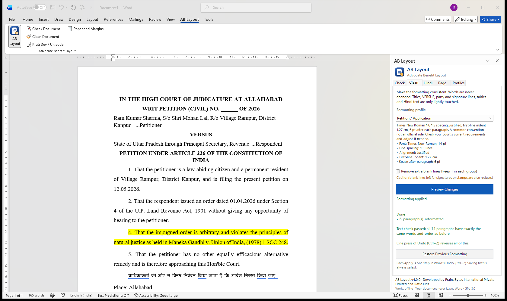
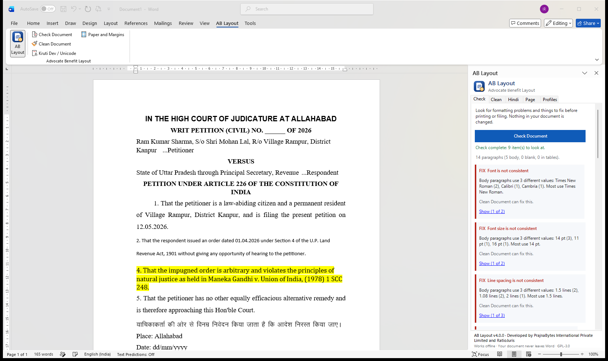
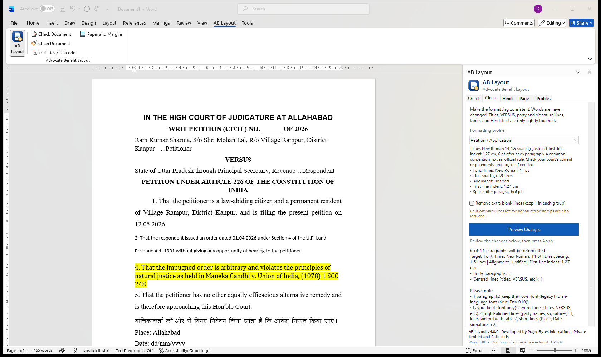
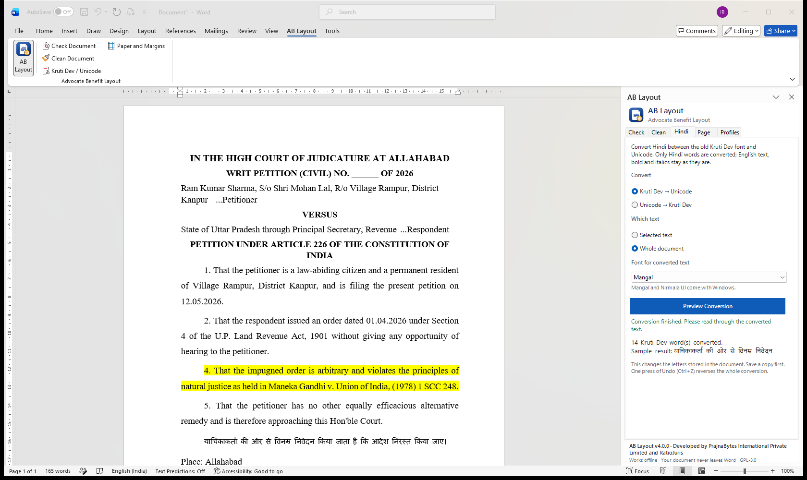
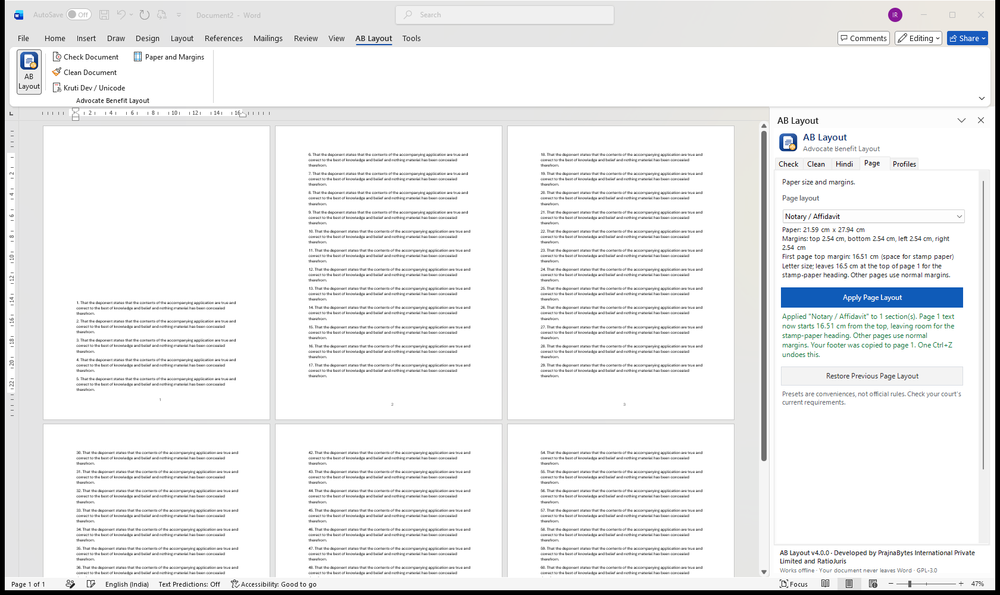
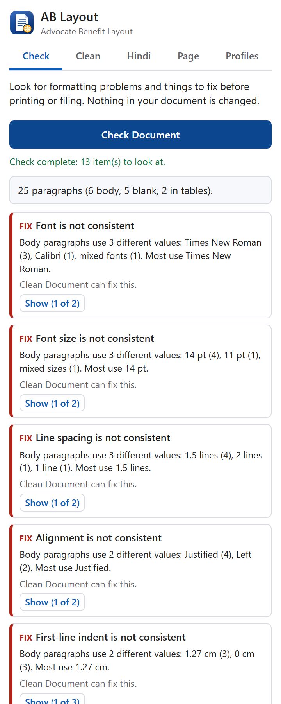

<h1 align="center">AB Layout</h1>

<b>Advocate Benefit Layout</b> — court-ready documents in Microsoft Word, without changing a word.

  <a href="https://ratiojuris.github.io/ab-layout/">Website</a> ·
  <a href="docs/USER_GUIDE.md">User Guide</a> ·
  <a href="#install">Install</a> ·
  <a href="https://github.com/RatioJuris/ab-layout/issues">Get help</a>

  
  
  

**Developed by PrajnaBytes International Private Limited and RatioJuris.**

AB Layout is a free add-in for Microsoft Word that helps advocates in India
spend less time fighting document formatting. It checks your petition,
affidavit or written submission, makes the formatting consistent, converts
Hindi between Kruti Dev and Unicode, and sets paper and margins.

**No AI. No account. No subscription. Your document stays in Word.**

  <a href="https://github.com/RatioJuris/ab-layout/releases/latest/download/ABLayout-Setup.exe"><b>⬇ Download for Windows (ABLayout-Setup.exe)</b></a>

---

## What it does

### ✅ Check Document
Finds problems before you print or file, and jumps to each one:
- different fonts, sizes, line spacing, alignment or indents in the body text;
- paragraph numbers that skip or repeat ("Jumps from 3 to 5; 4 missing");
- blanks left to fill — `____`, `XXX`, `dd/mm/yyyy`;
- highlighted or coloured text, comments, unaccepted tracked changes;
- Hindi typed in the old Kruti Dev font;
- the wrong paper size (Word for Windows and Mac).

Nothing in your document is changed by a check.

### ✨ Clean Document
Makes the formatting consistent after showing you a preview.
- **Your words are never changed** — names, dates, citations and prayers stay exactly as written. After every run AB Layout reads the document again and confirms: *"Text check passed"*.
- The cause title, **VERSUS**, party and signature lines, tables and indented quotations keep their layout.
- Hindi (Kruti Dev or Unicode), other Indian languages and Urdu keep their own fonts.
- Changed your mind? **Restore Previous Formatting**, or one Ctrl+Z (Windows version).

Profiles to choose from:

| Profile | What it gives you |
|---|---|
| Make Consistent (match this document) | Keeps your own style; removes the inconsistencies. |
| Supreme Court A4 style (Circular 2020) | Times New Roman 14, 1.5 spacing; quotations 12 pt single. |
| Double-spaced 14 pt | Times New Roman 14, double spacing. |
| Petition / Application · Written Submission · Affidavit | Common conventions (Times New Roman 14, 1.5 spacing). |
| Office Copy (compact) | 12 pt, single spacing — for file and client copies. |
| Your own | Create, save and share your chamber's style. |

> Profiles are conveniences. They do **not** guarantee compliance with any
> court's rules — always check the current requirements of your court.

### 🔤 Kruti Dev ↔ Unicode Hindi
Converts Hindi inside Word, word by word — for the selected text or the whole
document. English words, numbers, bold and italics stay exactly as they are.
You see a preview first. Try it on the [website](https://ratiojuris.github.io/ab-layout/#hindi).

### 📄 Paper and margins
A4, legal-size and stamp-paper affidavit presets, including the Supreme Court
A4 layout (4 cm left/right, 2 cm top/bottom). For an **affidavit on stamp
paper**, page 1's text starts 16.5 cm down to leave room for the printed
stamp-paper heading, while every other page uses normal margins — no section
breaks, page numbers kept.

---

## Install

There are two versions. Both do the same checks and cleaning.

| | **Windows version** (recommended for Word on a PC) | **Web version** |
|---|---|---|
| Works in | Word 2013, 2016, 2019, 2021, 2024, Microsoft 365 on Windows | Word for the web, Word for Mac, Microsoft 365 |
| Internet | **Not needed** after installing | Needed to open the panel |
| Paper and margins | ✅ everywhere | Only recent Microsoft 365 desktop |
| Undo | **One Ctrl+Z** undoes each AB Layout action | Several Ctrl+Z may be needed |

### Windows version
1. Download **[ABLayout-Setup.exe](https://github.com/RatioJuris/ab-layout/releases/latest/download/ABLayout-Setup.exe)**.
2. Close Word and double-click **ABLayout-Setup.exe**. It installs for your Windows user only — no administrator password.
   If Windows says *"Windows protected your PC"*, click **More info → Run anyway**.
3. Open Word and click the **AB Layout** tab.

To remove it: **Settings → Apps → Installed apps → AB Layout → Uninstall**. Your profiles are kept.

*Can't run .exe files on your PC?* Use **[ABLayout-Word-Windows.zip](https://github.com/RatioJuris/ab-layout/releases/latest/download/ABLayout-Word-Windows.zip)** instead: extract it and double-click **install.cmd** (remove with **uninstall.cmd**).

### Web version (Word for the web and Mac)
1. Download **[manifest.xml](https://ratiojuris.github.io/ab-layout/manifest.xml)** from the [website](https://ratiojuris.github.io/ab-layout/).
2. In Word: **Insert → Add-ins → My Add-ins → Upload My Add-in**
   (some versions: **Home → Add-ins → More Add-ins → My Add-ins**).
3. Choose `manifest.xml`, then click the **AB Layout** tab → **AB Layout**.

**Updated the web version?** Close the panel and reload Word (Ctrl+F5 in
Word for the web). If it still shows an old version, remove the add-in and
upload `manifest.xml` again.

Word 2007 and 2010 cannot run either version.

---

## How to use it

1. **Check** → *Check Document* → read the list → *Show* jumps to each item.
2. **Clean** → choose a profile → *Preview Changes* → *Apply These Changes*.
3. Read through the document and **save** it.
4. **Hindi** → choose direction and text → *Preview Conversion* → *Convert Now*.
5. **Page** → choose a layout → *Apply Page Layout*.

Tip: **save your document before applying changes.** You can always use
*Restore*, Word's Undo (Ctrl+Z), or close without saving.

Step-by-step help for every option: **[User Guide](docs/USER_GUIDE.md)**.

---

## What works where

| | Windows version | Web version: Windows/Mac desktop | Web version: Word for the web |
|---|---|---|---|
| Check Document | ✅ | ✅ | ✅ |
| Clean Document and Restore | ✅ | ✅ | ✅ |
| Kruti Dev ↔ Unicode | ✅ | ✅ | ✅ |
| Paper size and margins | ✅ | Recent Microsoft 365 only | Use Word's *Layout → Size / Margins* |
| Comments and tracked changes check | ✅ | Newer versions | ✅ |
| Works offline | ✅ | — | — |

**Installed the Windows version but the AB Layout tab does not appear?**
- Make sure you opened **Word on your PC** (the Word app), not Word in a web browser.
- **File → Options → Add-ins**, choose **Disabled Items** in *Manage*, click
  **Go** and enable AB Layout (running `install.cmd` again also does this).
- **File → Options → Trust Center → Trust Center Settings → Add-ins**: if
  *"Require Application Add-ins to be signed by Trusted Publisher"* is ticked,
  Word skips AB Layout. Untick it (it is off in Word by default), or ask
  whoever manages your PC.

---

## Good to know

- *Restore* cannot bring back the exact mix of fonts inside a paragraph that had several; blank lines that you chose to remove are not brought back (use Undo or your saved copy).
- Paragraph numbers you typed by hand are **checked, not changed**, so references like "para 5" never silently break.
- Only Kruti Dev is converted at present (not Chanakya, DevLys or regional fonts).
- AB Layout is new: if something looks wrong in your version of Word, please [tell us](https://github.com/RatioJuris/ab-layout/issues) — include your Word version and a screenshot, **never a client's document**.

## Privacy

Your document is processed inside Word on your computer or in your Word for
the web session. AB Layout has no server, no account and no analytics, and it
never sends, stores or logs your document's text.

## ❤️ Sponsor a code-signing certificate

AB Layout is free for every advocate, and we want it to install as smoothly
on a district-court advocate's PC as on a big chamber's. Today the Windows
installer is signed with our own certificate, so Windows shows *"Windows
protected your PC"*, and offices that require signed add-ins skip AB Layout.

**A code-signing certificate from a recognised authority would fix this for
everyone.** If you or your organisation can sponsor one — or a cloud signing
service, or free signing for open-source projects — please reply on
**[issue #1: Help wanted – sponsor a code-signing certificate](https://github.com/RatioJuris/ab-layout/issues/1)**.
Sponsors are credited (with permission) here, on the website and in the
release notes. Thank you! 🙏

## Help and feedback

- 📘 [User Guide](docs/USER_GUIDE.md)
- 🐛 [Report a problem or suggest a feature](https://github.com/RatioJuris/ab-layout/issues)
- 🗺️ [What's planned](docs/PRODUCT_ROADMAP.md)

---

## License

Copyright © 2026 PrajnaBytes International Private Limited and RatioJuris.

AB Layout is free software under the **GNU General Public License v3.0 or
later** ([LICENSE](LICENSE)), with additional terms in [NOTICE](NOTICE): the
attribution "Developed by PrajnaBytes International Private Limited and
RatioJuris" must be kept, modified versions must be marked as such, and the
names "AB Layout", "RatioJuris" and "PrajnaBytes" may not be used for other
products. Kruti Dev → Unicode conversion is based on
[kru2uni](https://github.com/ltrc/kru2uni) (LTRC, IIIT Hyderabad).

AB Layout is not legal advice.

---

*Developers and contributors: see **[CONTRIBUTING.md](CONTRIBUTING.md)**.*
